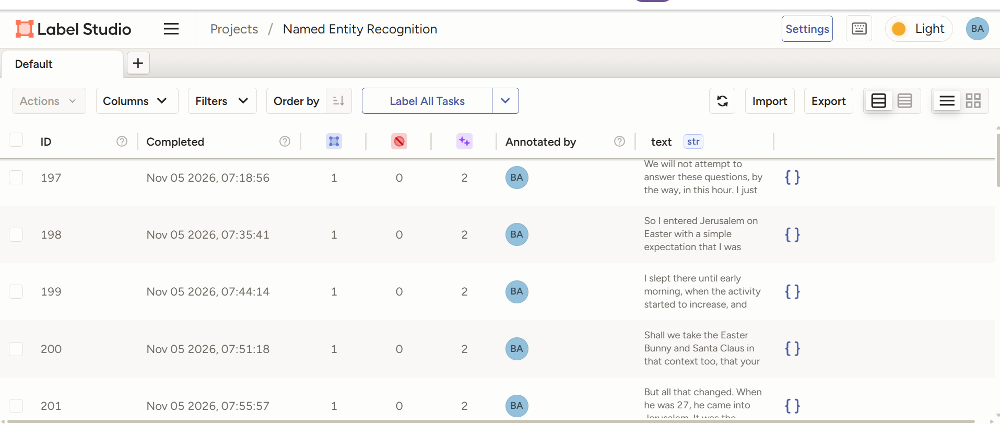
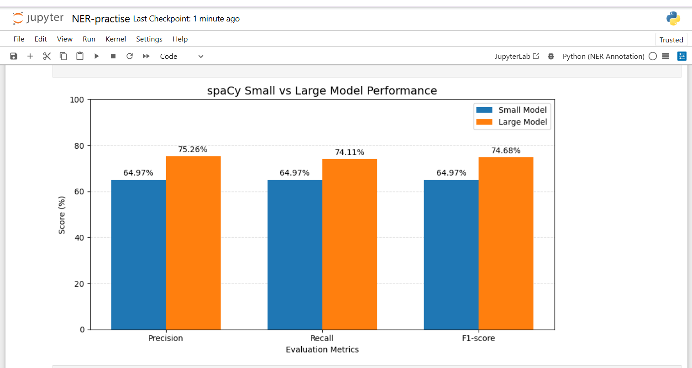

# Named Entity Recognition (NER) Model Evaluation

## Project Overview

This project explores Named Entity Recognition (NER) using **spaCy**, with a focus on evaluating and comparing the performance of two pre-trained English language models: `en_core_web_sm` and `en_core_web_lg`.

Using transcript data from *This American Life* episodes, I generated entity predictions with both models, reviewed annotations using Label Studio, and evaluated model performance against human reference annotations.

The project demonstrates a practical workflow for preparing text data, generating NER predictions, reviewing model outputs, and measuring model performance.

## Project Objectives

- Explore Named Entity Recognition using spaCy.
- Generate entity predictions using two pre-trained models.
- Review and annotate model predictions using Label Studio.
- Compare model predictions against human reference annotations.
- Evaluate model performance using precision, recall, and F1-score.
- Visualise the results to identify differences in model performance.

## Tools and Technologies

| Tool | Purpose |
|---|---|
| Python | Data preparation and evaluation |
| Pandas | Data loading and manipulation |
| spaCy | Named Entity Recognition |
| Label Studio | Annotation review and human reference annotation |
| Jupyter Notebook | Development and analysis |
| Matplotlib | Data visualisation |

## Project Structure

```text
ner-model-evaluation/
│
├── NER-exercise-public.ipynb
├── NER-practise-public.ipynb
├── README.md
│
└── images/
    ├── ner-annotation.png
    ├── completed-annotations.png
    ├── evaluation-results.png
    └── model-comparison.png
```

## Project Workflow

The project is divided into two main stages.

### Stage 1: Data Preparation and NER Predictions

**Notebook:** `NER-exercise-public.ipynb`

The first notebook covers:

1. Loading the cleaned transcript dataset using Pandas.
2. Inspecting the dataset and handling missing or empty transcript lines.
3. Loading the spaCy English language models:
   - `en_core_web_sm`
   - `en_core_web_lg`
4. Selecting a subset of transcript data for evaluation.
5. Generating Named Entity Recognition predictions using both models.
6. Preparing the predictions for review and annotation in Label Studio.

### Stage 2: Annotation Review and Model Evaluation

**Notebook:** `NER-practise-public.ipynb`

The second notebook focuses on evaluating model performance.

The process involved:

1. Loading the original tasks and model predictions generated in the first notebook.
2. Loading the completed annotations exported from Label Studio.
3. Comparing model predictions against human reference annotations.
4. Identifying true positives (TP), false positives (FP), and false negatives (FN).
5. Calculating precision, recall, and F1-score.
6. Visualising the results to compare the two models.

## Annotation Process

Label Studio was used to review model predictions and establish human reference annotations for the evaluation samples.

The annotation process provided a reference against which the predictions from both spaCy models could be assessed.

### 1. Label Studio Annotation Interface

The screenshot below shows the Label Studio annotation interface used to review named entities in the transcript samples.


### 2. Completed Annotation Tasks

This screenshot shows the completed annotation tasks in Label Studio following the annotation review process.



## Evaluation Methodology

The evaluation used **exact entity matching**.

A predicted entity was counted as a true positive when its start position, end position, and entity label matched the corresponding human reference annotation.

- **True Positive (TP):** A predicted entity that correctly matched a reference entity.
- **False Positive (FP):** A predicted entity that did not match a reference entity.
- **False Negative (FN):** A reference entity that the model failed to identify correctly.

The following metrics were used:

### Precision

Measures the proportion of predicted entities that were correct.

$$
Precision = \frac{TP}{TP + FP}
$$

### Recall

Measures the proportion of reference entities that the model correctly identified.

$$
Recall = \frac{TP}{TP + FN}
$$

### F1-score

The harmonic mean of precision and recall.

$$
F1 = 2 \times \frac{Precision \times Recall}{Precision + Recall}
$$

## Evaluation Results

The evaluation was conducted on **34 transcript samples**.

| Metric | en_core_web_sm | en_core_web_lg |
|---|---:|---:|
| True Positives | 128 | 146 |
| False Positives | 69 | 48 |
| False Negatives | 69 | 51 |
| Precision | 64.97% | 75.26% |
| Recall | 64.97% | 74.11% |
| F1-score | 64.97% | 74.68% |

### 1. Model Performance Comparison

The chart below presents a comparison of precision, recall, and F1-score for the two spaCy models.


### 2. Evaluation Results from Python

The screenshot below shows the evaluation results generated in the Jupyter Notebook, including the true positives, false positives, false negatives, precision, recall, and F1-score for both models.



### Key Findings

- `en_core_web_lg` achieved a higher precision, recall, and F1-score than `en_core_web_sm` on the evaluated samples.
- The large model recorded an F1-score of **74.68%**, compared with **64.97%** for the small model.
- The large model also produced fewer false positives and false negatives in this evaluation.
- The results suggest that `en_core_web_lg` performed better on this particular transcript sample.

These findings are limited to the 34 samples evaluated in this project and should not be interpreted as a general performance comparison of the two spaCy models across all datasets or domains.

## Dataset Source and Access

The project uses the **This American Life Episode Transcripts** dataset, available on Kaggle.

- **Dataset:** [This American Life Episode Transcripts](https://www.kaggle.com/datasets/thedevastator/this-american-life-episode-transcripts)
- **Kaggle uploader:** The Devastator
- **Original data credited to:** Chris Jewell

The original dataset and its cleaned CSV file are not included in this repository. Users interested in reproducing the analysis should obtain the dataset from its original Kaggle listing and follow the preparation instructions in the first notebook.

The dataset listing displays a CC BY-SA 4.0 licence. However, users should independently review the dataset's licensing and underlying content rights before redistributing any transcripts or derived files.

## Running the Project

### 1. Clone the Repository

```bash
git clone https://github.com/barbzyqueen/ner-model-evaluation.git
cd ner-model-evaluation
```

### 2. Install Dependencies

Install the required Python packages:

```bash
pip install pandas spacy matplotlib jupyter
```

### 3. Download the spaCy Models

Run the following commands:

```bash
python -m spacy download en_core_web_sm
python -m spacy download en_core_web_lg
```

Note that `en_core_web_lg` is a considerably larger model and requires additional download time and storage space.

### 4. Obtain the Dataset

Download the transcript dataset from [Kaggle](https://www.kaggle.com/datasets/thedevastator/this-american-life-episode-transcripts).

Place the cleaned `lines_clean.csv` file in a folder named `data` within the project directory.

The expected structure is:

```text
ner-model-evaluation/
│
├── data/
│   └── lines_clean.csv
│
├── NER-exercise-public.ipynb
└── ...
```

### 5. Run the First Notebook

Open `NER-exercise-public.ipynb` in Jupyter Notebook and execute the cells.

This notebook generates model predictions and exports the tasks required for annotation.

### 6. Complete the Annotation Process

Import the generated `tasks.json` file into Label Studio, review the annotations, and export the completed annotations as `annotations.json`.

### 7. Run the Evaluation Notebook

Ensure that both `tasks.json` and `annotations.json` are available in the project directory.

Open `NER-practise-public.ipynb` and execute the cells to calculate evaluation metrics and generate the model comparison chart.

**Note:** The generated JSON files are not included in this repository because they contain podcast transcript text.

## Limitations

- The evaluation was conducted on a relatively small sample of 34 transcript entries.
- The results are specific to the selected transcript data and entity annotations.
- Exact matching was used, meaning differences in entity boundaries or labels were counted as mismatches.
- The evaluation does not establish how the models would perform on other datasets or text domains.

## Conclusion

This project provided practical experience with Named Entity Recognition, model prediction review, human annotation, and evaluation.

Comparing `en_core_web_sm` and `en_core_web_lg` against human reference annotations demonstrated how precision, recall, and F1-score can be used to assess NER model performance.

It also highlighted the importance of human review when evaluating automated entity extraction systems.

## Author

**Barbara**

[GitHub Profile](https://github.com/barbzyqueen)
